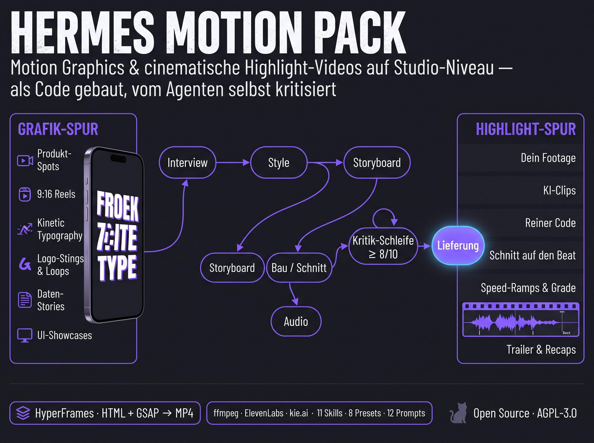

<div align="center">

**🚧 STATUS: BETA v0.2**



# 🎬 Hermes Motion Pack

**Motion Graphics und cinematische Highlight-Videos auf Studio-Niveau — als Code gebaut, vom Agenten selbst kritisiert.**

<p align="center">
  <a href="#-lizenz"></a>
  
  
  <a href="https://github.com/oliverhees/hermes-motion-pack/actions/workflows/tests.yml"></a>
  <a href="https://aiianer.de"></a>
</p>

[🇬🇧 English](README.md) · **🇩🇪 Deutsch**

[Installation](#-installation) · [Benutzen](#-benutzen) · [Wann nutze ich was?](#-wann-nutze-ich-was) · [Was drin ist](#-was-drin-ist) · [So funktioniert es](#-so-funktioniert-es) · [Prompts](prompts/README.md) · [Einsteiger-Anleitung](docs/START-HERE.de.md) · [Lizenz](#-lizenz)

</div>

---

## Was ist das?

Hermes Motion Pack sind **11 verkettete Skills** für den
[Hermes Agent](https://github.com/NousResearch/hermes-agent), die aus einem Satz ein
fertiges Video machen: Produkt-Spots, 9:16-Reels, Launch-Teaser, Logo-Stings,
Daten-Stories, UI-Showcases — und **cinematische Highlight-Videos, Trailer und Recaps**
aus deinem eigenen Footage, aus KI-Clips oder rein aus Code.

Videos sind hier **Programme, keine Generierungen**: HTML + GSAP, gerendert mit
[HyperFrames](https://github.com/heygen-com/hyperframes), Schnitte mit ffmpeg, jede
Zahl und jedes Easing deterministisch. Der Agent interviewt dich zuerst, schreibt ein
Briefing, klaut sich eine Referenz für den Look, macht ein Storyboard, baut, mischt den
Ton, **schaut sich seine eigenen Frames an**, bewertet sie, bessert nach — und liefert
erst, wenn jeder Score ≥ 8/10 ist.

**Teil des AIIANER-Ökosystems:** Bei [AIIANER](https://aiianer.de) bauen wir ein
KI-Betriebssystem auf Basis von [Hermes](https://github.com/NousResearch/hermes-agent).
Hermes selbst ist ein Open-Source-Projekt von **Nous Research** — dies ist eine
unabhängige Community-Erweiterung ohne offizielle Verbindung zu Nous Research.

## Warum?

> Der Prompt ist 10 % des Videos. Der Harness ist die anderen 90 %.

Bitte einen Agenten um „ein cooles Video", und du bekommst zentrierten Text, der über
einen Farbverlauf einblendet. Nicht, weil das Modell es nicht besser könnte — sondern
weil ihm niemand eine Referenz, eine Zustandsliste pro Beat, einen Blick auf das eigene
Ergebnis und die Erlaubnis zur Selbstkritik gegeben hat. Dieser Pack ist dieser Harness.
Bewusst ohne Talking Heads und Avatar-Erklärvideos.

## ✨ Was drin ist

| Skill | Macht |
|---|---|
| `motion-pack` | **Hier starten.** Fragt zuerst, führt die Kette mit Freigabe-Toren, merkt sich den Stand |
| `mp-brief` | Antippbares Interview (max 2 × 3 Fragen) → `BRIEF.md` |
| `mp-style` | Referenz-getriebenes Design-Dokument, 8 Presets (clean-product, editorial-brutal, neo-glass, kinetic-type, hand-drawn, cinematic-dark, data-minimal, retro-print) → `STYLE.md` |
| `mp-storyboard` | Beats, Zustandslisten, Sprechtext, SFX-Hits → `STORYBOARD.md` |
| `mp-build` | Eine HTML/GSAP-Szene pro Beat auf gemeinsamem Design-System → `npx hyperframes lint` → Entwurf |
| `mp-audio` | ElevenLabs-Stimme (Key nur aus Env), Musik-Ducking, SFX, Zwei-Pass-Lautheit (-14 LUFS) |
| `mp-critique` | Contact-/Phone-/Strip-/Loop-Sheets, 8 Kriterien mit Score 1–10, Fix-Liste, Schleife bis ≥ 8 |
| `mp-ship` | Final-Render in allen Formaten, `DELIVERY.md`, „diese Pipeline als Skill speichern" |
| `mp-footage` | Dein eigenes Material: Proxies, Szenenschnitte, Bewegungs-/Lautheits-/Sprach-Scores → beste Momente |
| `mp-genclip` | KI-Clips (Seedance, Veo, Kling via kie.ai) Shot für Shot, Look-gelockt, Kosten vorher |
| `mp-highlight` | Beat-synchroner Cinematic-Schnitt: Speed-Ramps, Grade, Grain, Letterbox, Flash; Titel, Glitch, Light-Leaks, Zähler als Overlays |

Dazu **12 fertige Prompts** in [`prompts/`](prompts/README.md) — inklusive Master-Prompt,
der mit jedem Coding-Agenten funktioniert, auch ohne den Pack — und getestete Scripts für
Lautheit, Contact Sheets, Footage-Scan, Beat-Grid und Export.

## 🧩 So funktioniert es

```
du: /motion-pack Mach mir einen 15-Sekunden-Reel für mein Tool
 │
 ├─ mp-brief      3 Fragen → BRIEF.md ────────────────────── OK?
 ├─ mp-style      Preset oder Referenz → STYLE.md ─────────── OK?
 ├─ mp-storyboard Beats + Zustandslisten → STORYBOARD.md ──── OK?
 │
 ├─ GRAFIK-Spur:    mp-build     scenes/*.html + GSAP → lint → draft.mp4
 ├─ HIGHLIGHT-Spur: mp-footage / mp-genclip → SHOTLIST.json
 │                  mp-highlight beats.json → EDIT.json → Base-Cut → Overlays
 │
 ├─ mp-audio      Stimme + Musik + SFX → -14-LUFS-Mix ─────── du hörst rein
 ├─ mp-critique   Sheets → Scores → Fix-Liste ─┐
 │                 alles ≥ 8? nein → zurück ────┘
 └─ mp-ship       Final-Renders + DELIVERY.md
```

1. Du beschreibst das Video in einem Satz. Hermes stellt die 3 Fragen, die zählen, nicht mehr.
2. Hermes schreibt das Briefing, schlägt einen Look vor, storyboardet jeden Beat als Zustandsliste.
3. Es baut Szenen als Code (oder schneidet dein Footage auf den Beat) und rendert einen Entwurf.
4. Es erzeugt Contact Sheets vom eigenen Render, bewertet sie wie ein strenger Motion Director, bessert nach, wiederholt.
5. Du bekommst die Dateien, ein `DELIVERY.md` mit jeder Quelle und jeder ungeprüften Behauptung — und optional einen neuen Skill, mit dem das nächste Video in diesem Stil ein Einzeiler ist.

## 🚀 Installation

**Voraussetzungen:** Hermes Agent · Node ≥ 22 · ffmpeg · Python 3 (+ `numpy` für die Beat-Erkennung).
Optional: Sprecherstimme über die in Hermes eingebaute ElevenLabs-Unterstützung (Key in `hermes setup` eintragen); KI-Clips über unseren [kie.ai-MCP-Server](https://github.com/oliverhees/kie-ai-mcp-server), in Hermes verbunden.

**Hermes installiert selbst:** diesen Prompt in einen beliebigen Hermes-Chat einfügen (CLI, Desktop, Telegram). Er prüft die Abhängigkeiten, installiert die Skills, fragt nach optionalen Keys und endet mit einem Test-Render.

```
Installier mir bitte den hermes-motion-pack (github.com/oliverhees/hermes-motion-pack) komplett und eigenständig. Mach es in dieser Reihenfolge und melde nach jedem Schritt kurz OK oder was fehlt:

1. Voraussetzungen prüfen: node >= 22, ffmpeg, python3, numpy. Was fehlt, installier über den Paketmanager dieses Systems (bei node: nodejs.org / nvm; numpy: pip install numpy). Nichts stillschweigend überspringen.
2. Das Repo als Skill-Tap hinzufügen: hermes skills tap add oliverhees/hermes-motion-pack
3. Diese 11 Skills installieren (Sicherheitsscan bestätigen, falls gefragt): motion-pack, mp-brief, mp-style, mp-storyboard, mp-build, mp-audio, mp-critique, mp-ship, mp-footage, mp-genclip, mp-highlight – jeweils mit: hermes skills install oliverhees/hermes-motion-pack/<skill> (2–3 pro Befehl, nicht alle auf einmal). Blockiert der Sicherheitsscan einen Skill: zeig mir die markierten Zeilen, prüf sie gegen das Repo und kopiere den Skill nur bei harmlosem Befund manuell: cp -r <repo>/skills/<skill> ~/.hermes/skills/<skill>
   Falls der Tap-Weg nicht klappt: Repo nach ~/motion-studio/hermes-motion-pack klonen und dort bash install.sh ausführen.
4. Den offiziellen HyperFrames-Skill installieren: hermes skills install official/creative/hyperframes (steht dort „already installed“, der Skill fehlt aber in hermes skills list: cp -r ~/.hermes/hermes-agent/optional-skills/creative/hyperframes ~/.hermes/skills/creative/hyperframes)
5. Prüfen, dass npx hyperframes --version läuft (beim ersten Mal wird es heruntergeladen).
6. Den /motion-Shortcut anlegen: motion.bundle.yaml aus dem Repo nach ~/.hermes/skill-bundles/motion.yaml kopieren (Repo dafür notfalls klonen).
7. Mich fragen, ob ich die optionalen Extras einrichten will: (a) Sprecherstimme: Hermes hat ElevenLabs bereits eingebaut, ich trage meinen ElevenLabs-Key direkt in Hermes ein (`hermes setup`), niemals im Chat; (b) KI-Clips: den kie.ai-MCP-Server von https://github.com/oliverhees/kie-ai-mcp-server in Hermes verbinden (`hermes mcp add`), der kie.ai-Key liegt auf diesem Server. Ohne sie läuft alles außer Stimme und KI-Clips.
8. Testlauf: bash ~/.hermes/skills/motion/mp-build/scripts/init_project.sh ~/motion-studio/_smoketest 1080 1920 30 2 (Pfad notfalls anpassen), dann dort npx hyperframes lint und npx hyperframes render --quality draft --output out/test.mp4. Wenn ein MP4 entsteht, bist du fertig.
9. Am Ende: hermes skills list zeigen, mir sagen, dass ich /reload-skills selbst im Chat tippen muss (es ist ein Chat-Befehl), und mir in drei Zeilen sagen: ✅ installiert, ⚠️ was fehlt, 👉 mein erster Befehl (z. B. /motion-pack Mach mir einen 15-Sekunden-Reel für …).
```

**Andere Agenten:** `bash install.sh --target .claude/skills` (Claude Code) oder jeder Ordner, der `SKILL.md`-Skills lädt. Die Prompts in `prompts/` funktionieren überall.

➡️ **Einsteiger-Anleitung, jeder Schritt mit „Fertig, wenn":** [docs/START-HERE.de.md](docs/START-HERE.de.md)

## 🎬 Benutzen

```
/motion-pack Mach mir einen 15-Sekunden-Reel für mein Tool, 9:16, deutsch
/motion-pack Schneid mir aus dem Ordner ~/footage/launch ein 30-Sekunden-Highlight-Reel, episch, auf den Beat
/motion-pack 8-Sekunden-Launch-Teaser für Acme, cinematic dark, Datum enthüllen
/mp-critique                                      ← „warum sieht das billig aus?" auf jeden Render
```

Hermes stellt ≤ 3 Fragen, dann läuft die Kette. Du sagst an jedem Tor OK. „Wo waren wir?" setzt jedes Projekt fort.

## 🔌 Mehr erreichen mit ElevenLabs und kie.ai

Das Pack läuft komplett ohne Keys: Motion Graphics als Code und Schnitte aus deinem eigenen Footage. Zwei optionale Verbindungen ergänzen, was Code und ffmpeg allein nicht können:

| | Ohne Extras | + ElevenLabs | + kie.ai-MCP |
| --- | --- | --- | --- |
| **Bilder** | Motion Graphics als Code, Schnitte aus eigenem Footage | wie links | **KI-Clips** (Seedance, Veo, Kling) und **KI-Standbilder** (gpt-image, nano-banana) als Shots für Trailer und Highlight-Reels, Look-gelockt, Kosten vorher |
| **Stimme** | Stumm + Musik | **Sprecherstimme** in Sprache und Stimme deiner Wahl, mit Wort-Zeitstempeln, damit Untertitel und Schnitte auf den Worten sitzen | wie links |
| **Videos, die du machen kannst** | Spots, Reels, Typografie, Data Stories, Recaps aus deinem Footage | Erklärvideos und Produktfilme mit Sprecher | **Trailer und cinematische Teaser komplett ohne Footage** |

**So verbindest du sie**
- **ElevenLabs:** Hermes hat ElevenLabs bereits eingebaut. Trag deinen Key direkt in Hermes ein (`hermes setup`). `mp-audio` im Pack nutzt denselben Key.
- **kie.ai:** verbinde unseren [kie.ai-MCP-Server](https://github.com/oliverhees/kie-ai-mcp-server) in Hermes (`hermes mcp add`). Der kie.ai-Key liegt auf diesem Server, nie im Pack.

Der kie.ai-MCP bietet außerdem Musik (Suno), Soundeffekte, Upscaling und Freistellen. Die Skills rufen diese noch nicht automatisch auf, aber du kannst Hermes im selben Chat danach fragen, zum Beispiel nach einem eigenen Musikbett für einen Trailer.

## 🧭 Wann nutze ich was?

**Faustregel:** Starte mit `/motion-pack`. Das führt durch die ganze Kette und ruft die passenden Teil-Skills selbst auf. Einen einzelnen `mp-*`-Skill nimmst du nur, um genau einen Schritt zu wiederholen. Eine Vorlage aus [`prompts/`](prompts/README.md) nimmst du, wenn du schon weißt, welche Art Video du willst.

### Nach Situation

| Deine Situation | Das machst du | Prompt-Vorlage |
| --- | --- | --- |
| Produkt oder Tool, kein Footage, du brauchst einen Spot | `/motion-pack` + ein Satz | [01 Produktspot](prompts/01-product-spot-30s.md), [06 UI-Showcase](prompts/06-ui-showcase-30s.md) |
| Social-Hook nur aus Worten und Zahlen | `/motion-pack` | [02 Kinetic Typography](prompts/02-reel-kinetic-typography.md), [08 Zitat](prompts/08-quote-manifesto-reel.md), [05 Data Story](prompts/05-data-story-20s.md) |
| Launch oder Datum enthüllen | `/motion-pack` | [03 Launch-Teaser](prompts/03-launch-teaser-8s.md) |
| Logo-Animation, loopbar | `/motion-pack` | [04 Logo-Sting](prompts/04-logo-sting-loop.md) |
| Vorher/Nachher, Vergleich | `/motion-pack` | [07 Vorher/Nachher](prompts/07-before-after-reel.md) |
| **Du hast Footage** (Gameplay, Event, Vlog) | `/motion-pack` + Ordnerpfad. Es läuft `mp-footage`, dann `mp-highlight` | [09 Highlight-Reel](prompts/09-highlight-reel-footage.md), [11 Event-Recap](prompts/11-event-recap.md) |
| **Kein Footage, aber cinematische Shots** | `/motion-pack` + „generier die Clips“. Es läuft `mp-genclip` (braucht den [kie.ai-MCP](https://github.com/oliverhees/kie-ai-mcp-server)) | [10 Trailer mit KI-Clips](prompts/10-trailer-ai-clips.md) |
| Ein Render existiert und sieht billig oder falsch aus | `/mp-critique` | keine |
| Anderer Look, gleiche Story | `/mp-style`, dann `/mp-build` | keine |
| Stimme, Musik oder Lautstärke stimmt nicht | `/mp-audio` (Stimme braucht deinen ElevenLabs-Key in Hermes) | keine |
| Freigegeben, du brauchst alle Formate | `/mp-ship` | keine |
| Du kommst nach einer Pause zurück | „Wo waren wir?“ | keine |

### Nach Schritt

| Schritt | Skill | Einzeln starten, wenn … | Ergebnis |
| --- | --- | --- | --- |
| 1 | `mp-brief` | du unsicher bist, was das Video leisten soll | `BRIEF.md` |
| 2 | `mp-style` | du einen neuen Look willst | `STYLE.md` (8 Presets) |
| 3 | `mp-storyboard` | Tempo oder Reihenfolge der Beats nicht passt | `STORYBOARD.md` |
| 4 | `mp-build` | eine Szene geändert oder neu gerendert werden soll | HyperFrames-Projekt, Draft-MP4 |
| 5 | `mp-audio` | der Ton das Problem ist | Mix bei -14 LUFS |
| 6 | `mp-critique` | irgendetwas „nicht ganz stimmt“ | Scores 1-10, die 3 größten Probleme |
| 7 | `mp-ship` | die Kritik grün ist | Final-Renders, `DELIVERY.md` |
| Seite | `mp-footage` / `mp-genclip` / `mp-highlight` | du mit echtem oder KI-Footage arbeitest | `SHOTLIST.json`, Beat-Schnitt |

### Eine typische Session

1. `/motion-pack Mach mir einen 15-Sekunden-Reel für <dein Tool>, 9:16, deutsch`
2. Beantworte die 3 Fragen, gib dann Brief, Look und Storyboard frei (die Gates).
3. Schau dir den Draft an. Wirkt er falsch, starte `/mp-critique` oder sag in eigenen Worten, was stört.
4. Wiederhole, bis alle Scores bei 8 oder höher liegen, und sag dann „ship it“ für alle Formate plus `DELIVERY.md`.
5. Sag Ja, wenn Hermes anbietet, die Pipeline als Skill zu speichern. Das nächste Video in diesem Stil ist dann ein Satz.

### Stolperfallen

- **Fragen überspringen** führt zu generischen Videos. Im Brief lässt sich am billigsten korrigieren.
- **Zu früh final rendern** kostet Zeit. Auf Drafts iterieren und erst nach grüner Kritik shippen.
- **Die Extras sind optional**: alles außer Sprecherstimme (ElevenLabs-Key in Hermes) und KI-Clips (kie.ai-MCP) läuft ohne.
- **Bei Footage** brauchst du einen Ordnerpfad, keine Beschreibung. Gib Hermes die echten Dateien.

## 🧪 Tests

`bash tests/smoke.sh` lässt jedes Script auf synthetischem Material laufen (kein Netz, keine Keys):
Frontmatter, Audio-Mix trifft -14 LUFS, Kritik-Sheets, Footage-Scan findet den lauten Moment,
Beat-Grid, gegradeter Base-Cut, Export. Die CI legt zusätzlich ein HyperFrames-Projekt an und lintet es.

## 🔧 Status

**Beta v0.2** — ehrliche Checkliste:

- [x] 11 Skills mit Hermes-Frontmatter (Tags, Env-Var-Deklarationen, Dateilisten)
- [x] Alle Scripts auf synthetischem Material im sauberen Linux-Container getestet
- [x] `init_project.sh` → `npx hyperframes lint` → `npx hyperframes render` → MP4 verifiziert
- [x] Audio-Mix bei -14 LUFS / -1 dBTP verifiziert
- [x] Footage-Scan, Beat-Grid, gegradeter Base-Cut verifiziert
- [ ] Komplette Agenten-Session Ende-zu-Ende in Hermes (bitte melden, was klemmt)
- [ ] ElevenLabs-TTS-Script gegen die Live-API (braucht Key)
- [ ] kie.ai-Toolnamen zur Laufzeit geprüft (der Skill lässt den Agenten die Tools erst entdecken)
- [ ] Video-Clip-Attribute für den Base-Cut in einer HyperFrames-Komposition (Skill verweist auf den offiziellen HyperFrames-Skill)

---

## 🌍 Das AIIANER-Universum

| | |
| --- | --- |
| 🏠 **Community** | [aiianer.de](https://aiianer.de) — Kurse, Labs, Tutorials, KI-Coaches |
| 📺 **YouTube** | [youtube.com/@aiianer](https://www.youtube.com/@aiianer) — Tools, Tests, Deep Dives |
| 🔒 **Datenschleuse** | [github.com/oliverhees/datenschleuse](https://github.com/oliverhees/datenschleuse) — DSGVO-Filter für deine KI |
| 🛡️ **coolify-shield** | [github.com/oliverhees/coolify-shield](https://github.com/oliverhees/coolify-shield) — Server dichtmachen |
| 📬 **Gmail Guard** | [github.com/oliverhees/hermes-gmail-guard](https://github.com/oliverhees/hermes-gmail-guard) — Hermes liest, du sendest |

## 📜 Lizenz

Dual lizenziert: **AGPL-3.0** (private Nutzung, Creator, Agenturen, Forschung) oder
**kommerzielle Lizenz** (geschlossene Produkte/Dienste, keine Quellcode-Offenlegung).
Die Videos, die du damit machst, gehören dir. Details: [LICENSING.md](LICENSING.md).
Anfragen über die [AIIANER Community](https://aiianer.de) oder **hi@aiianer.de**.

## Sicherheit

Bitte **keine** öffentlichen Issues für Sicherheitslücken. Siehe [SECURITY.md](SECURITY.md).

## Marken

„AIIANER" ist eine Marke von Oliver Hees aka Aiianer. Die Code-Lizenz gewährt
**keine** Rechte an diesem Namen oder Logo. Forks müssen einen eigenen Namen verwenden.

„Hermes" ist ein Open-Source-Projekt von **Nous Research**
([github.com/NousResearch/hermes-agent](https://github.com/NousResearch/hermes-agent)).
„HyperFrames" ist ein Open-Source-Projekt von HeyGen. „GSAP" ist eine Marke von Webflow, Inc.
„ElevenLabs" und „kie.ai" sind Marken ihrer Inhaber. Dieses Projekt ist unabhängig
und mit keinem davon verbunden.

---

<p align="center">
  © 2026 <strong>Oliver Hees aka Aiianer</strong> ·
  <a href="https://aiianer.de">aiianer.de</a> ·
  Made with 🖤 in the AIIANER universe
</p>
