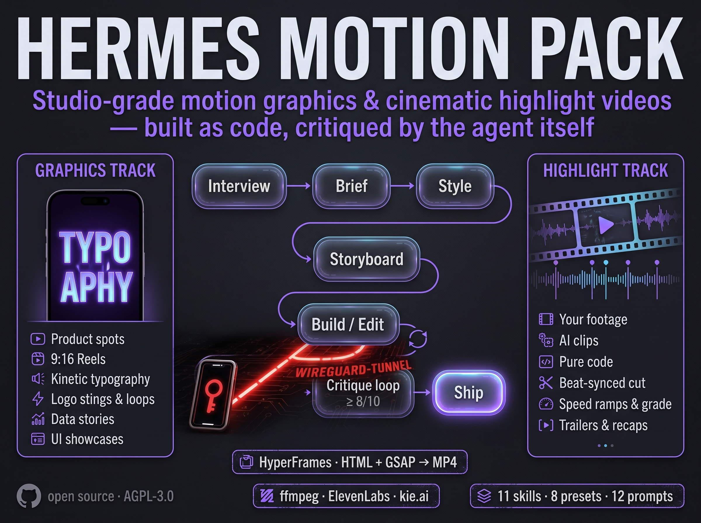

<div align="center">

**🚧 STATUS: BETA v0.2**



# 🎬 Hermes Motion Pack

**Studio-grade motion graphics and cinematic highlight videos — built as code, critiqued by the agent itself.**

<p align="center">
  <a href="#-license"></a>
  
  
  <a href="https://github.com/oliverhees/hermes-motion-pack/actions/workflows/tests.yml"></a>
  <a href="https://aiianer.de"></a>
</p>

**🇬🇧 English** · [🇩🇪 Deutsch](README.de.md)

[Install](#-install) · [Use](#-use) · [What's inside](#-whats-inside) · [How it works](#-how-it-works) · [Prompts](prompts/README.md) · [Beginner guide](docs/START-HERE.md) · [License](#-license)

</div>

---

## What is this?

Hermes Motion Pack is a set of **11 chained skills** for the
[Hermes Agent](https://github.com/NousResearch/hermes-agent) that turn a one-line
request into a finished video: product spots, 9:16 reels, launch teasers, logo
stings, data stories, UI showcases — and **cinematic highlight videos, trailers and
recaps** cut from your own footage, from AI-generated clips, or from pure code.

Videos are **programs, not generations**: HTML + GSAP rendered with
[HyperFrames](https://github.com/heygen-com/hyperframes), edits assembled with ffmpeg,
every number and easing deterministic. The agent interviews you first, writes a brief,
steals a reference for the look, storyboards, builds, mixes audio, **looks at its own
frames**, scores them, fixes, and only ships when every score is ≥ 8/10.

**Part of the AIIANER ecosystem:** At [AIIANER](https://aiianer.de) we build an
AI operating system on top of [Hermes](https://github.com/NousResearch/hermes-agent).
Hermes itself is an open-source project by **Nous Research** — this is an
independent community extension and has no official affiliation with Nous Research.

## Why?

> The prompt is 10 % of the video. The harness is the other 90 %.

Ask an agent for "a cool video" and you get centred text fading over a gradient.
Not because the model can't do better — because nobody gave it a reference, a state
list per beat, a way to see its own output, and permission to be harsh with itself.
This pack is that harness. No talking heads, no avatar explainers, on purpose.

## ✨ What's inside

| Skill | Does |
|---|---|
| `motion-pack` | **Start here.** Interviews first, runs the chain with approval gates, remembers where you are |
| `mp-brief` | Tap-friendly interview (max 2 × 3 questions) → `BRIEF.md` |
| `mp-style` | Reference-driven design doc, 8 presets (clean-product, editorial-brutal, neo-glass, kinetic-type, hand-drawn, cinematic-dark, data-minimal, retro-print) → `STYLE.md` |
| `mp-storyboard` | Beats, state lists, voice lines, SFX hits → `STORYBOARD.md` |
| `mp-build` | One HTML/GSAP scene per beat on a shared design system → `npx hyperframes lint` → draft render |
| `mp-audio` | ElevenLabs voice (key from env only), music ducking, SFX, two-pass loudness (-14 LUFS) |
| `mp-critique` | Contact / phone / strip / loop sheets, 8 criteria scored 1–10, fix list, loop until ≥ 8 |
| `mp-ship` | Final renders in all formats, `DELIVERY.md`, "save this pipeline as a skill" |
| `mp-footage` | Your own clips: proxies, scene cuts, motion / loudness / speech scores → best moments |
| `mp-genclip` | AI clips (Seedance, Veo, Kling via kie.ai) shot by shot, look-locked, cost shown first |
| `mp-highlight` | Beat-synced cinematic cut: speed ramps, grade, grain, letterbox, flash; titles, glitch, light leaks, counters as overlays |

Plus **12 ready prompts** in [`prompts/`](prompts/README.md) — including a master prompt that
works with any coding agent, even without the pack — and tested scripts for loudness,
contact sheets, footage scanning, beat grids and exports.

## 🧩 How it works

```
you: /motion-pack Mach mir einen 15-Sekunden-Reel für mein Tool
 │
 ├─ mp-brief      3 questions → BRIEF.md ──────────────────── OK?
 ├─ mp-style      preset or reference → STYLE.md ───────────── OK?
 ├─ mp-storyboard beats + state lists → STORYBOARD.md ──────── OK?
 │
 ├─ GRAPHICS track:  mp-build     scenes/*.html + GSAP → lint → draft.mp4
 ├─ HIGHLIGHT track: mp-footage / mp-genclip → SHOTLIST.json
 │                   mp-highlight beats.json → EDIT.json → base cut → overlays
 │
 ├─ mp-audio      voice + music + SFX → -14 LUFS mix ───────── you listen
 ├─ mp-critique   sheets → scores → fix list ─┐
 │                 all ≥ 8? no → back to build ┘
 └─ mp-ship       final renders + DELIVERY.md
```

1. You describe the video in one sentence. Hermes asks the 3 questions that matter, nothing more.
2. Hermes writes the brief, proposes a look, storyboards every beat as a state list.
3. It builds scenes as code (or cuts your footage on the beat), renders a draft.
4. It generates contact sheets of its own render, scores them like a harsh motion director, fixes, repeats.
5. You get the files, a `DELIVERY.md` with every source and every unverified claim — and optionally a new skill that makes the next video in this style a one-liner.

## 🚀 Install

**Requirements:** Hermes Agent · Node ≥ 22 · ffmpeg · Python 3 (+ `numpy` for beat detection).
Optional: `ELEVENLABS_API_KEY` for voice-over, `KIE_API_KEY` or the kie.ai MCP for AI clips.

**Lazy mode — let Hermes install it:** paste the prompt from [docs/HERMES-INSTALL-PROMPT.md](docs/HERMES-INSTALL-PROMPT.md) into any Hermes chat. It checks dependencies, installs the skills and keys, and ends with a test render.

**One line in Hermes:**

```bash
hermes skills tap add oliverhees/hermes-motion-pack && for s in motion-pack mp-brief mp-style mp-storyboard mp-build mp-audio mp-critique mp-ship mp-footage mp-genclip mp-highlight; do hermes skills install oliverhees/hermes-motion-pack/$s; done && hermes skills install official/creative/hyperframes
```

That adds the repo as a skill tap, installs the 11 skills with Hermes' security scan, and the
official HyperFrames skill (the composition format). Start a new session afterwards.

**Alternative — git clone:**

```bash
git clone https://github.com/oliverhees/hermes-motion-pack.git && cd hermes-motion-pack
bash install.sh                                      # checks deps, copies skills to ~/.hermes/skills/motion/
hermes skills install official/creative/hyperframes
```

**Optional `/motion` shortcut:** copy `motion.bundle.yaml` to `~/.hermes/skill-bundles/motion.yaml` — then `/motion <request>` loads the whole pack at once.

**Other agents:** `bash install.sh --target .claude/skills` (Claude Code) or any folder that loads `SKILL.md` skills. The prompts in `prompts/` work anywhere.

➡️ **Beginner guide, every step with "Done when":** [docs/START-HERE.md](docs/START-HERE.md)

## 🎬 Use

```
/motion-pack Mach mir einen 15-Sekunden-Reel für mein Tool, 9:16, deutsch
/motion-pack Schneid mir aus dem Ordner ~/footage/launch ein 30-Sekunden-Highlight-Reel, epic, auf den Beat
/motion-pack 8-second launch teaser for Acme, cinematic dark, reveal the date
/mp-critique                                      ← "why does this look cheap?" on any render
```

Hermes asks ≤ 3 questions, then runs the chain. You say OK at each gate. "Wo waren wir?" resumes any project.

## 🧪 Tests

`bash tests/smoke.sh` runs every script on synthetic media (no network, no keys): frontmatter,
audio mix hits -14 LUFS, critique sheets, footage scan finds the loud peak, beat grid, graded
base cut, exports. CI also scaffolds a HyperFrames project and lints it.

## 🔧 Status

**Beta v0.2** — honest checklist:

- [x] 11 skills with Hermes frontmatter (tags, env-var declarations, file lists)
- [x] All scripts tested on synthetic media in a clean Linux container
- [x] `init_project.sh` → `npx hyperframes lint` → `npx hyperframes render` → MP4 verified
- [x] Audio mix verified at -14 LUFS / -1 dBTP
- [x] Footage scan, beat grid, graded base cut verified
- [ ] Full agent session end-to-end inside Hermes (please report what breaks)
- [ ] ElevenLabs TTS script against the live API (needs a key)
- [ ] kie.ai tool names re-checked at runtime (skill tells the agent to discover them)
- [ ] Video-clip attributes for the base cut inside a HyperFrames composition (skill defers to the official HyperFrames skill)

---

## 🌍 The AIIANER universe

| | |
| --- | --- |
| 🏠 **Community** | [aiianer.de](https://aiianer.de) — courses, labs, tutorials, AI coaches |
| 📺 **YouTube** | [youtube.com/@aiianer](https://www.youtube.com/@aiianer) — tools, tests, deep dives |
| 🔒 **Datenschleuse** | [github.com/oliverhees/datenschleuse](https://github.com/oliverhees/datenschleuse) — GDPR filter for your AI |
| 🛡️ **coolify-shield** | [github.com/oliverhees/coolify-shield](https://github.com/oliverhees/coolify-shield) — lock down your server |
| 📬 **Gmail Guard** | [github.com/oliverhees/hermes-gmail-guard](https://github.com/oliverhees/hermes-gmail-guard) — Hermes reads, you send |

## 📜 License

Dual licensed: **AGPL-3.0** (private use, creators, agencies, research) or a
**commercial license** (closed products/services, no source disclosure).
The videos you make with it are yours. Details: [LICENSING.md](LICENSING.md).
Requests via the [AIIANER Community](https://aiianer.de) or **hi@aiianer.de**.

## Security

Please do **not** report vulnerabilities as public issues. See [SECURITY.md](SECURITY.md).

## Trademarks

"AIIANER" is a trademark of Oliver Hees aka Aiianer. The code license grants
**no** rights to this name or logo. Forks must use their own name.

"Hermes" is an open-source project by **Nous Research**
([github.com/NousResearch/hermes-agent](https://github.com/NousResearch/hermes-agent)).
"HyperFrames" is an open-source project by HeyGen. "GSAP" is a trademark of Webflow, Inc.
"ElevenLabs" and "kie.ai" are trademarks of their owners. This project is independent
and not affiliated with any of them.

---

<p align="center">
  © 2026 <strong>Oliver Hees aka Aiianer</strong> ·
  <a href="https://aiianer.de">aiianer.de</a> ·
  Made with 🖤 in the AIIANER universe
</p>
